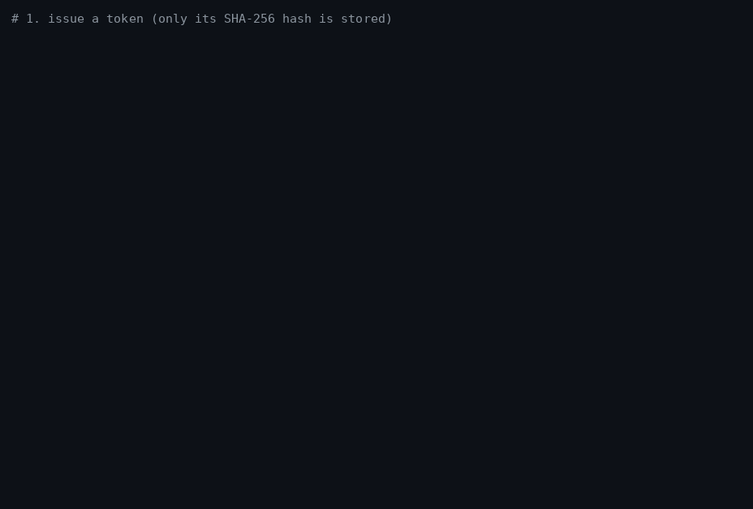

# mcp-ops-server

[](https://github.com/nikhilll30/mcp-ops-server/actions/workflows/ci.yml)

A production-shaped [MCP](https://modelcontextprotocol.io) server that lets AI agents act on a
booking system safely: scopes and patient binding enforced in server code, expiring and revocable
tokens (static or OAuth 2.1 JWTs), an encrypted tamper-evident audit log, encryption at rest, rate
and size limits, and a container that CI boots and tests on every PR. It comes with **trajectory-level agent evals**
and a **CI gate** that blocks a merge when a known-good agent flow breaks.

The reference domain is a **synthetic** clinic (providers, open slots, referrals, appointments),
because it has real multi-step tasks and real security stakes. It runs on SQLite or in front of a
**FHIR R4** server, and CI proves both give identical results. A second synthetic domain, a
**salon** (stylists, openings, visits), runs on the same [`mcp-ops-kit`](mcp_ops_kit/README.md):
auth, limits, server wiring, harness, grader and CI gate, extracted from what the two domains
share. Phase 2 (see [Roadmap](#roadmap)) is making the clinic **HIPAA-ready**; Part 9 added
the technical safeguards in code, and Part 10 a [Terraform blueprint](infra/aws/README.md) for
AWS, validated in CI and never applied.

All data is synthetic and generated from a fixed seed. No real names, patients or credentials
appear anywhere.

## Who it's for

| You are | Use it today for | Coming in Phase 2 |
|---|---|---|
| **A developer building an MCP server** | [`mcp-ops-kit`](mcp_ops_kit/README.md): scopes and a subject binding in code; tokens with audience, expiry and live revocation, or OAuth 2.1 JWTs; an encrypted, hash-chained audit log; encrypted SQLite; outputs cut to declared fields; per-client limits, a per-call deadline, a fail-closed server, a smoke test. Plus a schema-drift guard, a container smoke-tested in CI, and one `Backend` protocol with two stores held to the same tests | The kit on PyPI; signed images |
| **An agent team** | A trajectory grader, negative controls that prove it can fail, a CI eval gate and measured live runs, with a harness any domain plugs into (`EvalDomain`) | Repeated runs with pass^k, a prompt-injection suite |
| **Healthcare IT** | Studying a synthetic clinic with patient-bound tokens, and a FHIR R4 backend (Practitioner, Schedule/Slot, Appointment, ServiceRequest) tested against HAPI FHIR in CI, including concurrent booking. The 164.312 technical safeguards in code: audit log, expiring and revocable tokens, encryption at rest, minimum-necessary outputs. A [Terraform blueprint](infra/aws/README.md) on HIPAA-eligible AWS services (private Fargate, KMS everywhere, no internet path, least-privilege IAM), validated in CI, never applied. **Not** for real patient data (see [below](#can-i-use-it-with-real-patient-data)) | A HIPAA controls matrix, a threat model |
| **A booking business** (salon, tutor, repair) | A synthetic salon built on the kit (`salon_ops/`: 6 tools, its own scopes and customer-bound tokens, 18 golden tasks, 14 negative controls), and a [step-by-step guide](mcp_ops_kit/README.md) to building yours the same way. It got the audit log, expiring tokens and encryption at rest from the kit, with no salon-specific code | Repeated live runs and a prompt-injection suite, from the kit |
| **An evaluator or learner** | A build documented part by part: a failure log, one brief per part, every number linked to where it was measured, including what "HIPAA-ready" does and does not mean | The same for Parts 11–12 |

| | |
|---|---|
| **Server** | 6 MCP tools over Streamable HTTP · bearer tokens (static or OAuth 2.1 JWT) with scopes, patient binding, audience, expiry and live revocation · encrypted, hash-chained audit log · encrypted SQLite at rest · rate limit, body limit, per-call deadline |
| **Evals** | Clinic: 31 golden tasks graded step by step, and on the exact database change, plus 12 negative controls the grader must fail · Salon: 18 tasks and 14 controls, on the same kit |
| **Backends** | SQLite (default) or FHIR R4 (`MCP_OPS_BACKEND=fhir`), behind one protocol; same tool results, byte for byte, on every eval task |
| **CI** | lint · 521 tests · eval gates (clinic 31/31, 12/12; salon 18/18, 14/14) · a `fhir` job: 599 tests with every clinic tool test on both backends against HAPI FHIR, and the eval gate on FHIR · secret scan · the Docker image built, run read-only with no capabilities, smoke-tested and its audit log verified on every PR · a `terraform` job: fmt, validate, 17 `terraform test` runs on a mocked provider, tflint, checkov, and a HIPAA-eligible service check |
| **Live models** | `gpt-6-luna` **30/31** for **$0.046** · `gpt-6.1-sol` **30/31** for **$0.339** (all 31 tasks, one run each) |



<sub>A real run, rendered by [`docs/demo/record_demo.py`](docs/demo/record_demo.py) from the actual command output.</sub>

## Results

Real models, driving the server's own tools through the OpenAI Responses API, graded by the same code as CI:

| Model | Passed | Negative controls | Tool calls | Tokens in / out | Cost* | Task latency p50 / p99 |
|---|---|---|---|---|---|---|
| `gpt-6-luna` | 30/31 | 12/12 | 101 | 419k / 8.1k | $0.046 | 5.1 s / 25.0 s |
| `gpt-6.1-sol` | 30/31 | 12/12 | 84 | 147k / 4.5k | $0.339 | 8.1 s / 17.4 s |

\*This is an upper bound. It prices every input token at the full rate, but cached input is billed at 5–10% of that.
Both models ran on identical server and eval code, at default reasoning effort, on 2026-10-19.

- Every refusal, auth and referral-safety task passed for both models. These cover a pending or
  denied referral, the wrong patient, a slot in the past, and a double booking.
- Luna's one failure was correct but inefficient: it booked the right slot after 16 tool calls,
  and the limit is 6.
- Sol's one failure was over-cautious: after one slot clashed, it stopped instead of trying
  another. My own system prompt is ambiguous on that case, and I documented it rather than
  quietly tuning the prompt.

**The first live runs mostly found bugs in my eval, not in the models:**
- Chat Completions rejects tools combined with reasoning, so the agent moved to the Responses API.
- The report hid the error text, so it now shows failed calls in full.
- A tool said "Range at most 31 days", which was ambiguous. It now states the exact boundary.
- Two tasks needed information that no tool exposes. I only had it from reading the seed.

Each was fixed in the server or the task, never by loosening the grader. The rule I took from
it: a task may not need information no tool provides. All of this is in
[`FAILURES.md`](FAILURES.md) and [`evals/README.md`](evals/README.md).

## Run it

**Docker.** The image is published to GHCR from `main` and runs as a non-root user.

```bash
mkdir -p mcp-data
# 1. Issue a token (expires in 90 days). This prints it once; only its SHA-256 hash is stored.
docker run --rm --user "$(id -u):$(id -g)" -v "$PWD/mcp-data:/data" ghcr.io/nikhilll30/mcp-ops-server \
  python -m mcp_ops_server.auth issue --file /data/tokens.json --client me \
  --scope read:schedule --scope write:schedule --scope read:referrals
# 2. Make a data key; it encrypts the audit log. Keep it in your secret store.
export MCP_OPS_DATA_KEY=$(docker run --rm ghcr.io/nikhilll30/mcp-ops-server python -m mcp_ops_kit.crypto new-key)
# 3. Serve on http://127.0.0.1:8000/mcp (health probe: GET /healthz). Every tool call goes to
#    the audit log in the mcp-audit volume. Without a key, the container refuses to start.
docker run --rm -p 127.0.0.1:8000:8000 -v "$PWD/mcp-data:/data:ro" -v mcp-audit:/audit \
  -e MCP_OPS_DATA_KEY ghcr.io/nikhilll30/mcp-ops-server
# 4. From a checkout (pip install -e .): check it end to end. This tests health, a 401
#    without a token, then search, book and cancel.
MCP_TOKEN=<token from step 1> python scripts/smoke_test.py
# 5. Revoke the token while the server runs: refused from the next request, no restart.
docker run --rm --user "$(id -u):$(id -g)" -v "$PWD/mcp-data:/data" ghcr.io/nikhilll30/mcp-ops-server \
  python -m mcp_ops_server.auth revoke --file /data/tokens.json --client me
```

Tokens files from before Part 9 have no `version` and are refused at start-up with the fix:
`python -m mcp_ops_server.auth migrate --file tokens.json` (each token gets the server's
audience and a 90-day expiry). To use OAuth 2.1 access tokens from your own authorization
server instead of, or as well as, the tokens file, set `MCP_OPS_JWT_ISSUER` and
`MCP_OPS_JWT_JWKS` (see [`.env.example`](.env.example)).

Point any MCP client at `http://127.0.0.1:8000/mcp` with the header `Authorization: Bearer <token>`.
The image is not tied to any host. The same container runs on AWS App Runner/ECS, Fly or Cloud Run
with only configuration (env vars, see [`.env.example`](.env.example)). For AWS, the
[blueprint in `infra/aws/`](infra/aws/README.md) runs it privately on Fargate.

**On FHIR R4.** The same server in front of a FHIR server instead of SQLite. Locally, with the
HAPI FHIR image CI uses (synthetic data only: `fhir_seed load` writes the seed into it):

```bash
docker run -d --name hapi -p 127.0.0.1:8080:8080 hapiproject/hapi:v8.4.0-2   # ready in ~40 s
python -m mcp_ops_server.backends.fhir_seed load --url http://127.0.0.1:8080/fhir
MCP_OPS_BACKEND=fhir MCP_OPS_FHIR_URL=http://127.0.0.1:8080/fhir MCP_OPS_TOKENS_FILE=tokens.json \
  MCP_OPS_AUDIT_LOG=audit.log MCP_OPS_DATA_KEY=<key> python -m mcp_ops_server
MCP_OPS_TEST_BACKENDS=sqlite,fhir pytest -q                  # 599 tests, both backends
python -m evals.run --backend fhir --backend-url http://127.0.0.1:8080/fhir
```

The server never writes seed data itself. It refuses to start, with one line, if the FHIR URL is
unreachable, is not R4, or has no seed loaded.

**From source.** Requires Python 3.12+.

```bash
pip install -e ".[dev]"
ruff check . && ruff format --check . && pytest -q   # 521 tests (FHIR ones need the server above)
python -m evals.run                                  # 31/31 tasks passed; 12/12 negative controls caught
python -m mcp_ops_server                             # needs a tokens file, audit log, key: .env.example
```

**The salon example**, on the same kit (port 8100, `SALON_OPS_*` settings):

```bash
python -m salon_ops.evals.run                        # 18/18 tasks passed; 14/14 negative controls caught
python -m salon_ops.auth issue --file salon-tokens.json --client me \
  --scope read:catalog --scope write:bookings --scope read:customers
SALON_OPS_TOKENS_FILE=salon-tokens.json SALON_OPS_AUDIT_LOG=salon-audit.log \
  SALON_OPS_DATA_KEY=$(python -m mcp_ops_kit.crypto new-key) python -m salon_ops   # :8100/mcp
```

## How it works

```
 agent (scripted replay in CI, or an OpenAI model in live runs)
   │  MCP over Streamable HTTP + bearer token
   ▼
 mcp_ops_kit (domain-free)
   auth.py     token → scopes (+ subject binding); audience, expiry, revocation; hashes only
   oauth.py    OAuth 2.1 JWT access tokens: JWKS (file or URL), iss/aud/exp, jti revocation
   audit.py    one record per call: encrypted, HMAC-chained, no arguments; verify CLI
   crypto.py   data key → per-purpose subkeys; AES-256-GCM; atomic file replace
   limits.py   per-client rate limit, applied before argument validation
   server.py   audit + rate limit first, text rebuilt from validated output, /mcp, /healthz, serve
   sqlite.py   one deadline per call; with a key, the file on disk is encrypted
   evals/      harness: freshly seeded data + real server per task; records every call
               grader: required/forbidden steps, preconditions, subject scope, budgets, exact diff
               run: replay or live agent → results JSON + Markdown report + CI gate
 mcp_ops_server (the clinic)
   auth.py     AuthConfig: three scopes, tokens bound to a patient
   tools/      thin wrappers: check scope → call the Backend protocol → typed result
   backends/   base.py: the protocol, errors and shared messages
               sqlite.py: on the kit's SqliteStore, seeded from seed.py
               fhir.py: FHIR R4 REST; If-Match on every write; every result page followed
 evals         the clinic's EvalDomain, golden tasks and live-agent prompt
 salon_ops     the salon on the same kit: store, tools, AuthConfig, EvalDomain, golden tasks
```

| Tool | Scope | Notes |
|---|---|---|
| `health` | (any token) | status and version; counts toward the rate limit |
| `search_providers` | `read:schedule` | by specialty, location or name |
| `list_open_slots` | `read:schedule` | up to 31 days counting both ends; earliest first |
| `book_appointment` | `write:schedule` | approved referral required for referral specialties; no double booking, no past slots, no overlapping appointments |
| `cancel_appointment` | `write:schedule` | patient must match the appointment |
| `get_referral_status` | `read:referrals` | by patient, optionally specialty |

**Security is enforced in server code, never in prompts.**
- Every tool checks its scope.
- A patient-bound token (a "portal" token) can only act for its own patient.
- Tokens are stored as SHA-256 hashes. Each names its audience and expiry; a token for another
  server, an expired one or a revoked one is refused. Revocation reaches a running server on
  the next request.
- Each token gets its own session identity, so one token cannot touch another's session.
- Every tool call is written to an encrypted, hash-chained audit log (who, which token, tool,
  scope, subject ID, outcome, time), never the arguments. If a record cannot be written, the
  server stops acting.
- The server refuses to start without a token source, an audit log and a data key, and never
  keeps its database in a plaintext file.

**Evals grade what happened, not what the agent said.** The harness records every tool call that
reaches the server and diffs the appointments table before and after. A grader then checks the
ordered required steps, the forbidden steps, the preconditions (no specialist booking before the
referral check for *that* specialty), the patient scope, the call and error budgets, and the exact
final state. That includes appointments booked and then cancelled within a task.

Twelve deliberately bad trajectories must fail for their stated reason, which proves the grader
can fail. CI runs the free, deterministic replay agent on every PR. Paid live runs are triggered
by the owner from `main` only. The API key lives in a GitHub environment that only `main` can use.

## Adapt it to your domain

Part 8 built a second domain, a salon, by copying the clinic's code. It then moved what the two
copies shared into [`mcp_ops_kit`](mcp_ops_kit/README.md), whose guide walks through a new
domain step by step. The salon as a copy was 2,150 lines; on the kit it is 954, excluding its
task generator. The map today:

| Coupling | Files | What ties it to a domain |
|---|---|---|
| **Domain-free** | `mcp_ops_kit/` (auth, oauth, audit, crypto, limits, server, sqlite, errors, smoke, evals), `Dockerfile`, `.github/workflows/` | Nothing in the kit, and a test fails if it ever imports a domain. CI names each domain's commands (the `container` job issues clinic scopes for the smoke token). |
| **Configuration a domain writes** | `mcp_ops_server/auth.py`, `salon_ops/auth.py` | An `AuthConfig`: scope names, the subject claim and its ID pattern, the default audience |
| | `evals/run.py`, `salon_ops/evals/run.py` | An `EvalDomain`: principals, subject rule, clock, fresh data per task, live-agent prompt |
| | `server.py`, `config.py`, `__main__.py`, `scripts/smoke_test.py`, `salon_ops/smoke.py` | Which tools to register, extra settings, the env prefix, the smoke round trip |
| | `infra/aws/` | The clinic's `MCP_OPS_*` settings, its backend choice and the admin commands; another domain changes those names, the rest of the blueprint is generic |
| **The domain itself** | Clinic: `seed.py`, `models.py`, `tools/`, `backends/`, `evals/golden/`. Salon: `seed.py`, `models.py`, `store.py`, `tools.py`, `evals/golden/` | Replace these for a new domain (the FHIR mapping is clinic-specific by nature) |

Write golden tasks *and* negative controls for your domain before trusting the gate: the
salon's 14 controls cover every grader check, and three of them fail a refusal task that hit the wrong error.

## Can I use it with real patient data?

**Not by code alone.** Part 9 added the technical safeguards below and Part 10 an
infrastructure blueprint, but the controls matrix (Part 11) is still to come, and above all the
organisational half on the right. Phase 2 aims at **HIPAA-ready**, never "HIPAA compliant":
compliance belongs to an organisation, not to a repository.

| What Phase 2 code adds (45 CFR 164.312 technical safeguards) | What the adopter must still do |
|---|---|
| Tamper-evident audit log of every tool call, without the PHI arguments (Part 9, done) | Sign a **BAA with every vendor that touches PHI**: the hosting provider *and* the **LLM provider**, since tool results with PHI go into the model's context |
| OAuth 2.1 tokens with expiry and revocation without a restart, and audience binding (Part 9, done) | Run a risk analysis and keep risk management, policies and workforce training (164.308) |
| Encryption at rest for the SQLite store and the audit log, minimum-necessary tool outputs (Part 9, done; FHIR storage encryption is the FHIR server's) | Operate it in their own HIPAA-eligible accounts, with their own keys, backups, log retention and breach-notification process |
| A FHIR R4 backend so the server fronts an existing record system (Part 7, done) | Decide who gets which tokens, review access regularly, and pen-test their deployment |
| A [Terraform blueprint](infra/aws/README.md) on HIPAA-eligible AWS services, validated, never applied (Part 10, done) | Confirm each service against AWS's live list under their BAA, connect the private VPC to their network, run CloudTrail/GuardDuty at the account level, and decide on TLS for the last hop to the task |
| A controls matrix, threat model and `SECURITY.md` (Part 11) | Map the controls matrix to their own environment; anything marked "adopter's responsibility" is theirs |

The repo itself will only ever contain synthetic data. This section is engineering guidance, **not
legal advice**; talk to your privacy officer or counsel.

## Roadmap

| Part | What | State |
|---|---|---|
| 1–6 | Foundation, core server, hardening, evals, CI gate with live numbers, shipped container | Done |
| 7 | `Backend` protocol; FHIR R4 backend tested against HAPI FHIR in CI; parity with SQLite on every test and the eval gate | Done |
| 8 | A salon booking example built by copying the clinic, then `mcp-ops-kit` extracted from what both share; both eval gates run on the kit in CI | Done |
| 9 | Audit log, OAuth 2.1 expiry and revocation, audience binding, encryption at rest, data minimisation, in the kit | Done |
| 10 | Terraform blueprint on HIPAA-eligible AWS (private Fargate, EFS, KMS, WAF, least-privilege IAM), validated in CI, never applied | Done |
| 11 | HIPAA controls matrix (164.312), threat model, `SECURITY.md`, CodeQL, Dependabot, PyPI, signed images | Planned |
| 12 | Repeated live runs with pass^k, a prompt-injection suite | Planned |

The detailed plan is in [`comms/PLAN.md`](comms/PLAN.md).

## Engineering log

This repo is built in reviewed parts: six in Phase 1, and Parts 7–12 in Phase 2. Each part is
reviewed independently by Codex; every finding is reproduced before it is fixed, and each fix
has a test that fails without it.

- [`FAILURES.md`](FAILURES.md): what broke, what changed and what happened next, newest first.
  Every entry is a tested claim.
- [`docs/briefs/`](docs/briefs/): a one-page PDF brief per part.
- [`comms/PLAN.md`](comms/PLAN.md) and [`comms/STATUS.md`](comms/STATUS.md): the plan and where it stands.

## Known limits

- Token expiry is checked against the host's wall clock. If an edit breaks the tokens file (or
  the JWT revocation file), every token it governs is refused until it is fixed: a deliberate
  fail-closed choice, so a typo can cause an outage but never skip a revocation.
- The audit log detects an edited, deleted, inserted or reordered record, but not records cut
  off the *end*. `verify` prints the last sequence number and chain value; record them
  elsewhere to catch truncation later.
- The audit log records tool calls. A request refused at the HTTP layer (no token, or a bad,
  expired or revoked one) never reaches a tool, so it appears only in the server's access log
  as a 401.
- One process per audit log and per encrypted database file (each takes an exclusive lock).
  The encrypted database lives in memory and is rewritten in full on each committed write:
  about 3 ms for the clinic's 400 KB, but not a design for a large database.
- The per-call deadline covers everything up to COMMIT. Saving an encrypted database file
  happens after it and is not cut short, so a slow disk makes a write late, never falsely
  reported as failed.
- No key rotation yet: a new data key means a new audit log and database file.
- The rate limit is per process. Several replicas would each allow the full rate.
- The default database is in-memory and reseeds on every start. `MCP_OPS_DB=<path>` persists
  it, encrypted with `MCP_OPS_DATA_KEY`. With FHIR, encryption at rest is the FHIR server's job.
- The container listens on all interfaces, so the SDK's DNS-rebinding check (which is on only
  for localhost binds) is off. Every `/mcp` request still needs a bearer token. Publish the
  port on localhost, as above, unless you mean to expose it.
- The live results are single runs, so they say nothing about run-to-run variance.
- **FHIR backend.** The synthetic clinic keeps one fixed UTC offset (UTC-05:00, no daylight
  saving); Slot times are stored as UTC instants and converted. Every booking moves one
  sequence resource, so bookings are serialised (as SQLite's are), which caps write throughput.
  It assumes it is the only writer of Slot and Appointment status. A write cannot be cancelled
  once sent: if the FHIR server does not answer in time, the backend reads the result back and
  reports it, or says the outcome is unknown (with the appointment ID it would have) and that a
  retry is safe. It never reports "cancelled" for a write that may have landed. `fhir_seed load`/`reset` and
  the FHIR tests **overwrite** data: point them only at a throwaway server.

## License

MIT, see [`LICENSE`](LICENSE). All data is synthetic.
